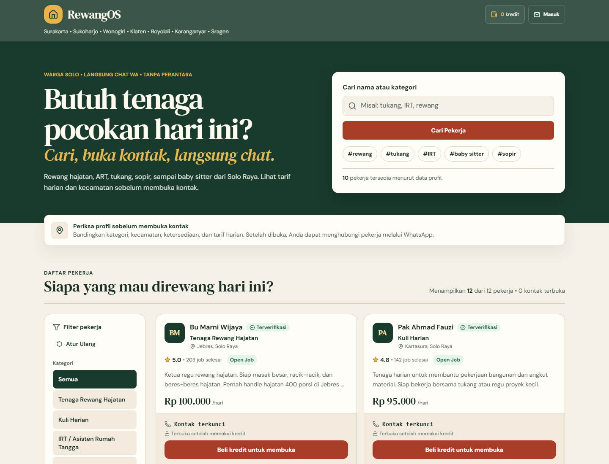
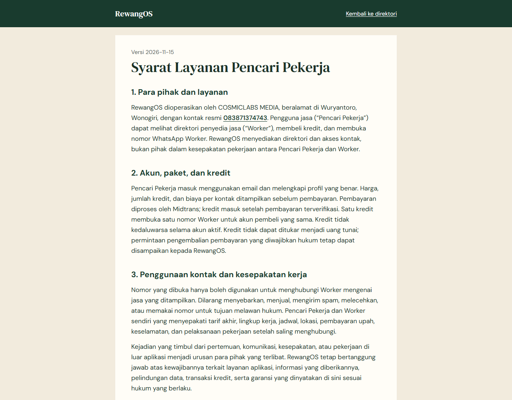

# RewangOS

Direktori tenaga pocokan untuk wilayah Solo Raya. Pencari pekerja dapat membandingkan profil, tarif harian, kecamatan, dan ketersediaan sebelum membuka kontak WhatsApp. Pengelolaan profil pekerja dilakukan oleh admin.

**Situs:** [rewang-os.cosmiclabs.web.id](https://rewang-os.cosmiclabs.web.id/)



## Fitur

### Pencari pekerja

- Cari pekerja berdasarkan nama atau kategori; saring menurut kategori, kecamatan, dan ketersediaan.
- Lihat kartu dan detail profil berisi tarif, pengalaman, keahlian, portofolio, rating, serta ulasan jika datanya tersedia.
- Masuk melalui email OTP, lengkapi profil pembeli, lalu lihat saldo kredit dan riwayat pembelian.
- Beli paket kredit melalui **Midtrans sandbox**. Kredit ditambahkan setelah notifikasi pembayaran diverifikasi, bukan dari callback browser.
- Buka satu kontak WhatsApp dengan satu kredit. Nomor hanya tampil bagi pembeli yang membukanya; tombol chat menyiapkan pesan awal.
- Laporkan nomor yang salah, tidak aktif, atau pekerja yang menolak dalam masa garansi kontak. Admin dapat meninjau laporan dan mengembalikan kredit bila disetujui.

### Admin

- Masuk dengan akun Supabase Auth yang memiliki `app_metadata.role = "admin"`.
- Tambahkan pekerja melalui formulir tiga langkah: identitas, pekerjaan, dan verifikasi. Formulir menampilkan pratinjau kartu profil.
- Unggah foto profil, portofolio, foto KTP privat, dan formulir persetujuan pekerja yang ditandatangani.
- Kelola izin tampil, status **Open Job/Busy**, serta penarikan listing. Tinjau laporan kontak pembeli.

### Dokumen layanan

Tersedia [Syarat Pencari Pekerja](https://rewang-os.cosmiclabs.web.id/legal/syarat-pencari-pekerja), [Ketentuan Worker](https://rewang-os.cosmiclabs.web.id/legal/ketentuan-worker), [Kebijakan Privasi](https://rewang-os.cosmiclabs.web.id/legal/kebijakan-privasi), dan formulir persetujuan pekerja yang dapat dicetak. Checkout mencatat persetujuan pembeli terhadap versi dokumen yang aktif.



## Menjalankan secara lokal

Proyek menggunakan React, TypeScript, Vite, Tailwind CSS, dan Supabase. Jalankan perintah berikut dari PowerShell:

```powershell
npm ci
Copy-Item .env.example .env
npm run dev
```

Isi `.env` dengan URL dan publishable/anon key proyek Supabase serta client key **Midtrans sandbox**. Variabel `VITE_*` tersedia di browser; jangan taruh server key atau service role key di sana. Server key Midtrans disimpan sebagai secret Supabase Edge Function.

Untuk proyek Supabase baru, siapkan skema dan fungsi sesuai [panduan pembayaran](supabase/PAYMENTS-SETUP.md), [input pekerja](supabase/WORKER-INTAKE-SETUP.md), dan [operasi legal](supabase/LEGAL-OPERATIONS.md). Perintah `npm run build` menjalankan pemeriksaan TypeScript dan membuat build produksi.

## Status integrasi

- Checkout pada kode ini memakai **Midtrans sandbox**; belum disiapkan untuk pembayaran produksi.
- Notifikasi WhatsApp kepada pekerja bersifat opsional dan memerlukan konfigurasi WhatsApp Cloud API serta template yang disetujui. Tanpa itu, klik chat tetap dapat dicatat.
- Data direktori, autentikasi, kredit, dan izin akses bergantung pada konfigurasi proyek Supabase. Repo ini tidak menyimpan `.env` maupun berkas sementara `supabase/.temp/`.
